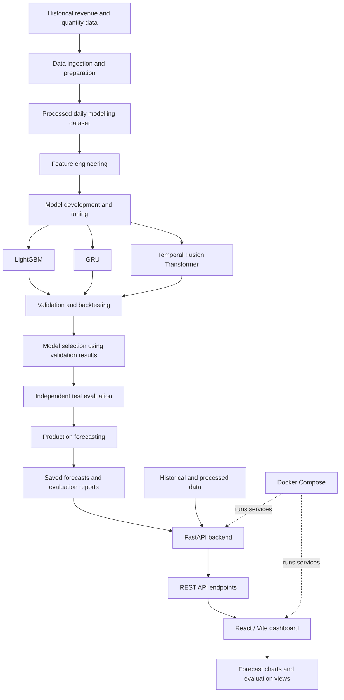

# Daily Multi-Horizon Probabilistic Forecasting

## 1. Overview

This project forecasts daily **Revenue** and **Quantity** for four products, up to 365 days ahead. It returns P10 (lower estimate), P50 (median) and P90 (upper estimate) quantiles to communicate forecast uncertainty.

The project combines data ingestion, feature engineering, model development, time-series validation, probabilistic forecasting, an API service and an interactive React dashboard.

## 2. Models and selection

The project compares LightGBM, GRU and Temporal Fusion Transformer (TFT) against a seasonal-naive benchmark. LightGBM was selected for production using validation results, with the lowest mean full-year MASE across validation folds, products and targets. The independent test set was not used for model selection.

## 3. Results

Validation performance:

| Model | MASE | Scaled pinball loss |
|---|---:|---:|
| LightGBM | **0.5601** | **0.1942** |
| GRU | 0.5805 | 0.2009 |
| TFT | 0.6071 | 0.2157 |

Independent test MASE (lower is better):

| Target | Horizon | GRU | LightGBM | TFT |
|---|---|---:|---:|---:|
| Quantity | First month | **0.640** | 0.666 | 0.726 |
| Quantity | First quarter | 0.609 | **0.586** | 0.655 |
| Quantity | Full year | 0.637 | **0.601** | 0.643 |
| Revenue | First month | **0.567** | 0.655 | 0.623 |
| Revenue | First quarter | **0.601** | 0.606 | 0.629 |
| Revenue | Full year | 0.670 | **0.630** | 0.685 |

GRU leads three of the six aggregate comparisons and LightGBM leads the other three. LightGBM remains the production model because selection was based on validation, not test results.

## 4. System architecture

The solution has two connected parts: an offline forecasting pipeline and an application layer that serves saved outputs.



### Architecture components

1. **Data and modelling pipeline:** Python scripts ingest and prepare historical data, create forecasting features, train and evaluate LightGBM, GRU and TFT, and produce saved forecasts and evaluation files.
2. **Forecast artefacts:** Production forecasts and evaluation summaries are stored under `reports/`. The processed modelling dataset is stored under `data/processed/`.
3. **FastAPI backend:** Exposes endpoints for health checks, historical data, forecast requests and model evaluation information.
4. **React dashboard:** Calls the backend API and presents historical data, forecasts and model-comparison information.
5. **Containerisation:** Docker and Docker Compose provide the local containerised setup. Nginx serves the built dashboard and proxies API requests to the backend.

**Serving limitation:** The current API reads `reports/production_forecast.csv`; it does not run fresh model inference for every request. The saved forecast supports LightGBM and forecast origin `2026-10-01`. Requested horizons must be covered by the saved forecast.

## 5. Project structure

```text
capstone/
├── configs/
│   └── default.yaml
├── data/
│   ├── raw/
│   ├── processed/
│   └── sample/
├── artifacts/
│   ├── tuning/
│   └── production/
├── reports/
├── src/
│   └── forecast/
│       ├── api/
│       ├── models/
│       ├── config.py
│       ├── constants.py
│       ├── features.py
│       ├── folds.py
│       ├── ingest.py
│       ├── interpret.py
│       ├── metrics.py
│       ├── run.py
│       └── tune.py
├── frontend/
├── tests/
├── Dockerfile
├── docker-compose.yml
├── requirements.txt
├── requirements-serve.txt
└── pyproject.toml
```

Generated data and artefacts may be excluded from version control. Reproducing model training requires access to the original source data.

## 6. Requirements

- Python 3.12
- Node.js and npm for the dashboard
- Docker Desktop for containerised execution

## 7. Local setup

Run commands from the project root.

### Python environment (Windows PowerShell)

```powershell
py -3.12 -m venv .venv
.venv\Scripts\Activate.ps1
python -m pip install --upgrade pip
pip install -r requirements.txt
pip install -e .
```

For API serving dependencies:

```powershell
pip install -r requirements-serve.txt
```

### Prepare data

Place source data at the location configured under `paths` in `configs/default.yaml`, then run:

```powershell
python -m forecast.run ingest --config configs/default.yaml
```

### Run the modelling pipeline

```powershell
python -m forecast.run tune --config configs/default.yaml
python -m forecast.run backtest --config configs/default.yaml
python -m forecast.run test --config configs/default.yaml
python -m forecast.run production --config configs/default.yaml
```

| Stage | Purpose |
|---|---|
| `ingest` | Prepare modelling data |
| `tune` | Tune hyperparameters using cross-validation |
| `backtest` | Evaluate validation folds and select the production model |
| `test` | Evaluate frozen models on the independent test period |
| `production` | Fit the selected approach and create the production forecast |

Do not use independent test results to select or retune the production model.

## 8. API

Start the backend from the project root:

```powershell
uvicorn forecast.api.main:app --reload --port 8000
```

- API documentation: `http://localhost:8000/docs`
- Health endpoint: `GET http://localhost:8000/health`
- Forecast endpoint: `POST http://localhost:8000/forecast`

Example request:

```json
{
  "product": "Product 1",
  "target": "Revenue",
  "model": "lgbm",
  "horizon": 30,
  "forecast_origin": "2026-10-01"
}
```

The API reads the saved production forecast rather than running fresh model inference for each request. The requested horizon must be covered by the saved forecast.

## 9. Dashboard

In a second terminal:

```powershell
cd frontend
npm install
npm run dev
```

Open the Vite URL shown in the terminal (normally `http://localhost:5173`). Keep the API and dashboard terminals running.

## 10. Docker

From the project root:

```powershell
docker compose up --build
docker compose ps
```

Stop the services:

```powershell
docker compose down
```

Check service names and port mappings in `docker-compose.yml`. Verify both services after the build.

## 11. Evaluation metrics

- **MASE:** MAE scaled by the in-sample seasonal-naive error. Below 1 indicates improvement over the seasonal benchmark.
- **MAE vs Seasonal Naive:** model MAE divided by benchmark MAE. Below 1 is better than the benchmark.
- **sMAPE:** symmetric percentage error; it can be unstable when actual and predicted values are near zero.
- **Pinball loss:** evaluates quantile forecasts. Lower is better.
- **Scaled pinball loss:** pinball loss divided by the seasonal-naive training scale.

Metrics are calculated on publication days. Aggregate tables use the mean across products, giving each product equal weight.

## 12. Limitations and future work

- Performance varies by product, target and horizon.
- sMAPE is unstable for some sparse or near-zero observations.
- TFT interpretation outputs were not successfully generated.
- The API serves pre-generated forecasts, not dynamic model predictions.
- Continuous feature-drift and forecast-performance monitoring have not been activated. An Evidently-based monitoring script is a proposed future enhancement.
- Reproducing training requires the original input data.

## 13. Reproducibility checklist

1. Install dependencies with Python 3.12.
2. Place source data at the configured path.
3. Run ingestion, tuning, backtesting, testing and production in order.
4. Start the API and verify `/health` and `/docs`.
5. Submit a forecast request and check dates and quantiles.
6. Run `docker compose up --build` and verify both containers.
7. Record the configuration and code version used for submission.
